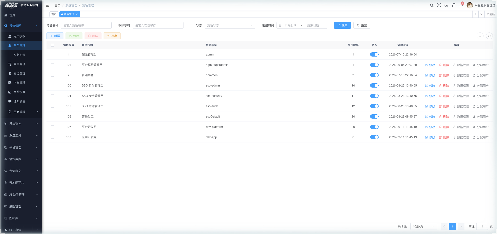
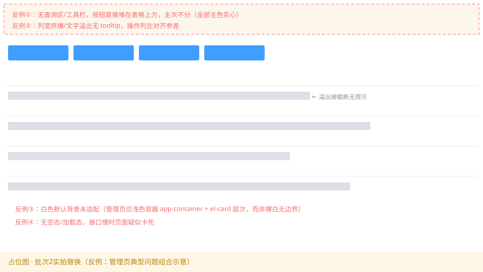
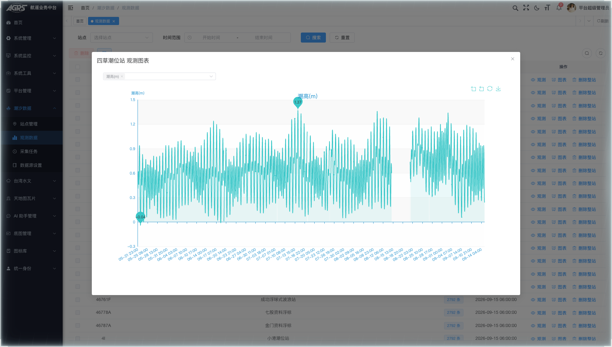
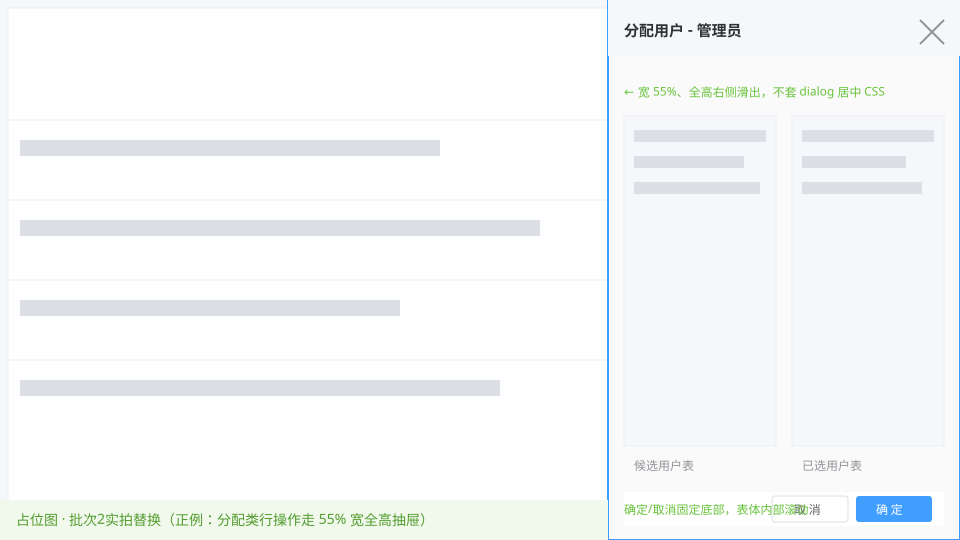
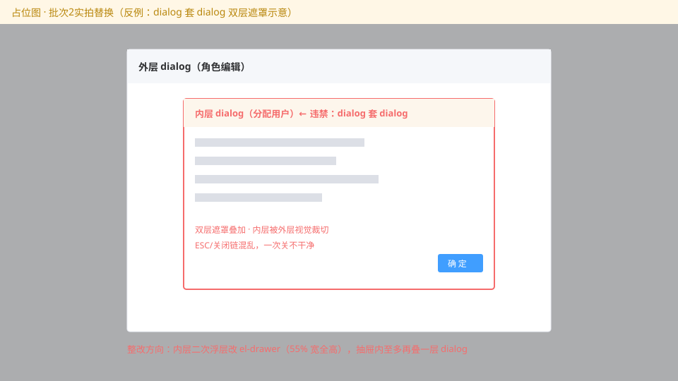
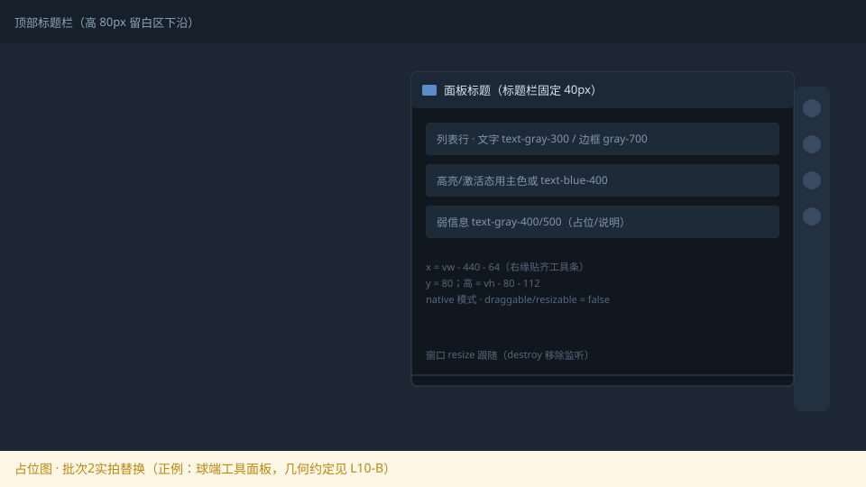
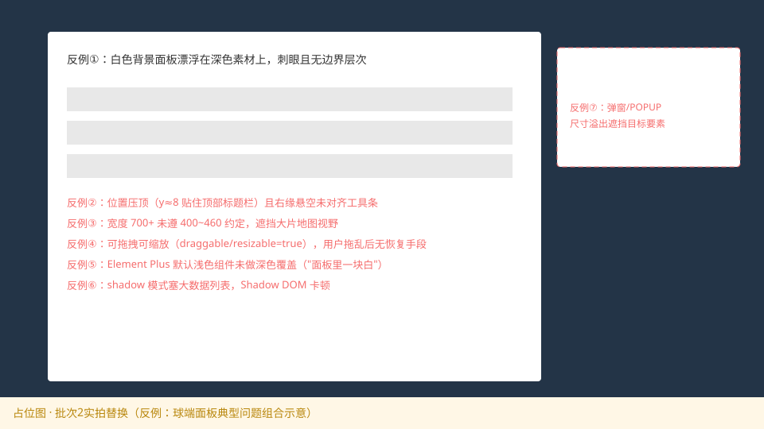

# L10 UI 规范（18850 管理页 + 球端面板）

> 没有规范大家做出来会五花八门——写任何 UI 前读本篇。截图位当前为**占位图**，
> 标注「批次2实拍替换」：批次 2 将从在架包实拍正例与整改前反例替换 `docs/images/` 对应文件。
> 验收 checklist 挂到 L5 各 recipe 的「UI 走查」项。

## A. 18850 管理面子页面规范（Element Plus，浅色）

### A.1 页面骨架（自上而下四段式）

```text
┌ 查询区    el-form :inline + v-show="showSearch"，label-width 68px，回车=搜索
├ 工具栏    el-row.mb8：主按钮（type=primary）+ 次按钮（plain）+ RightToolbar
├ 表格      el-table：加载 v-loading / 空态默认 / 列宽与对齐规则见 A.2
└ 分页      Pagination 全局组件（v-show="total>0"）
```

**撑满式列表（强制，2026-09-15 补入）**：列表页一律「视口撑满、表体内部滚动」——整页不出现浏览器级纵向滚动条。

```css
.app-container   { display: flex; flex-direction: column; height: calc(100vh - 84px); }
.table-container { flex: 1; min-height: 300px; overflow: hidden; }
```

模板：主列表 el-table 外包 `<div class="table-container">` 并 `height="100%"`；表体超高在 el-table 内部出滚动条，分页固定底部。
左树右表页：.app-container 为横向 flex（不加 column）；左侧面板容器 `overflow:hidden` + 树容器 `flex:1; overflow:auto`——树超高在面板内部滚动，不得撑高页面。
豁免：弹窗/抽屉内的表格由弹窗自管理高度，不套本范式。

参考实现：`skeletons/admin-ui/src/views/example/index.vue`；存量范式页 `views/resource/plugin/index.vue`。



**正例文字描述**：查询区内联紧凑、主按钮唯一高亮；表格表头灰底、文本列左对齐、数值与操作列居中；
超长列 `show-overflow-tooltip`；分页右下；加载有遮罩、空态有文案；权限按钮经 `v-hasPermi` 显隐。

**反例文字描述**：按钮全主色无层级；无查询区直接裸表格；列宽挤爆文字截断无提示；
无加载/空态（接口慢时疑似卡死）；裸白页面无 `app-container` 容器层次。



### A.2 表格与表单细则

| 项 | 规范 |
|:---|:---|
| 列对齐 | 文本左、数值/状态/操作居中；操作列固定宽 + `fixed="right"`（横向滚动常驻）；固定按钮数 ≤3（更多收入 dropdown） |
| 列宽填满 | 操作列与窄列（状态/开关/序号/日期）用固定 `width`；弹性文本列一律 `min-width`（不设 width），表格自动填满剩余宽度 |
| 操作列按钮 | **图标+文字**；tooltip 仅在**补充信息**（禁用原因/释义）或**按钮文字与 tooltip 不同**时才加——文字与按钮一致的 tooltip 属冗余，一律不加；图标-only 按钮（无文字）必须加 tooltip。**宽度按该页按钮内容实测测算，每页独立取值**——基准：2 字按钮≈54px / 3 字≈68px / 4 字≈82px / 纯图标 dropdown≈30px，间距 12px、列内边距 24px，`width = Σ按钮 + (n-1)×12 + 24`，**宁宽勿折行（必须一行放下）**；>4 收 dropdown；权限按钮 `v-hasPermi` 保留 |
| 列宽 | 不用万能宽；日期列 160~180；给 `min-width` 让表格自适应 |
| 表头 | `show-overflow-tooltip` 一律开；状态列用 `el-tag`（成功 success/失败 danger/进行中 warning） |
| 表单对话框 | 宽 500~600px，`append-to-body`，label-width 80px；必填项红星 + blur 校验 |
| 数据/图表弹窗 | **宽 70% + 高 70vh**（用户裁定 2026-09-15，宽高对称）；上下居中=`.el-overlay:has(.类名) .el-overlay-dialog{display:flex;align-items:center;justify-content:center}` + 弹窗 **`.el-dialog.类名{margin:0 !important;transform:none !important}`**（宿主 ruoyi.scss 有全局 `.el-dialog:not(.is-fullscreen){margin-top:6vh!important}`，选择器必须带 .el-dialog 前缀压过；EP align-center 残留 margin auto 一并清除）；内容区 flex:1 填满，`append-to-body` |


| 按钮层级 | 每屏主按钮 ≤1（primary）；其余 plain/text；删除/危险操作用 danger 且需二次确认 |
| 间距 | 段落间距 16/24；工具栏 `mb8`（8px）；查询区与表格 12px |
| 状态 | loading（表格 v-loading）/empty（接口空数据文案）/error（$modal 报错可重试）三态必做 |
| 权限 | 按钮级 `v-hasPermi` 与菜单 perms 一一对应；无权限不渲染（不是禁用） |

操作列图标约定（EP 组件名）：修改=Edit、删除=Delete、详情=View、新增=Plus、授权/数据权限=Key、分配用户=UserFilled、分配角色=Avatar、重置密码=Unlock、导出=Download、导入=Upload、刷新=Refresh、强退=SwitchButton、预览=View、生成=MagicStick、更多=MoreFilled（收入 dropdown）。

**字号层级（用户裁定 2026-09-16，EP 默认 14px 基线之上只允许下表取值）**：

| 层级 | 字号/字重 | 适用 |
|:---|:---|:---|
| 弹窗标题 | EP 默认（16px/600） | el-dialog title，不覆写 |
| 正文/表单 | EP 默认（14px） | 表单标签、输入内容、表格单元格、按钮文字 |
| 强调条标题 | **14px/600** | 警示条/提示条内标题（如「超管短路角色」） |
| 辅助说明 | **13px** | 警示条描述、补充说明文字、卡片次级信息 |
| 弱化信息 | **12px** | 时间戳、统计脚注、placeholder 提示 |

同一行内强调标题与辅助描述同框时（警示条模式：图标+标题+描述），垂直居中对齐、**显式 `text-align:left`**（防祖先居中样式继承漂移），宽度不足时描述自动折行，不用截断省略。

### A.3 浮层选用与弹窗嵌套禁忌（用户裁定 2026-09-16）

**弹窗嵌套禁忌**：禁止 dialog 内再开 dialog——双层遮罩叠加、焦点链/ESC/关闭行为混乱。需要二次浮层
一律改用 **el-drawer**；抽屉内最多再叠**一层** dialog，且该 dialog 内禁止再开任何浮层。
存量「dialog 套 dialog」整改方向 = 内层改抽屉。

**抽屉 vs 弹窗 vs 独立路由页选用边界**：

| 场景 | 承载 | 规格 |
|:---|:---|:---|
| 行级「分配/详情」、含多列表格/穿梭框/树表联动的二次浮层 | el-drawer | **默认宽 55%（`size="55%"`）、全高侧滑**；内容放不下时可适当放宽至 **75% 或更宽**（按内容实测取宽，以表格不折行/不拥挤为准）；`append-to-body` + `destroy-on-close`；`v-model` 布尔控制开关，提交成功 emit 通知父组件关闭并刷新列表；标题 = 动作 + 对象（如「分配用户 - 管理员」） |
| 轻表单、二次确认、数据/图表展示 | el-dialog | 尺寸沿用 A.2（表单 500~600px；数据/图表 70%×70vh）；A.2 居中 CSS 仅 dialog 适用 |
| 复杂多步流程、需深链直达/刷新保持的整页业务 | 独立路由页 | 走菜单路由，不用浮层硬塞 |

抽屉细则：

- A.2 的居中 CSS（`.el-overlay:has(.类名) .el-overlay-dialog` flex 居中）**只针对 dialog**；el-drawer 全高侧滑，**不套用**该居中 CSS；
- 抽屉宽度**默认 55%，按内容可放宽至 75% 或更宽**（用户补充裁定 2026-09-16）——多列表格 55% 出现折行/拥挤即上调，不设硬上限；
- 抽屉内多列表格由抽屉自管理高度（全高容器，表体内部滚动，不撑出页面级滚动条）；
- 典型先例：角色管理-分配用户、用户授权-分配角色，均由操作列行按钮打开（图标按 A.2 约定）。



**正例文字描述**：右侧滑出全高抽屉、占宽 55%；标题栏「分配用户 - 角色名」+ 关闭按钮；
内部候选/已选双表格（或穿梭框）分区排列、各区域内部滚动；确定/取消固定抽屉底部。

**反例文字描述**：dialog 上再叠 dialog 双层遮罩；内层弹窗被外层裁切、ESC 一次关不干净；
55% 宽才放得下的多列表格硬塞进 500px 弹窗，滚动态套滚动态。



## B. 球平台工具插件规范（深色主题）

### B.1 面板大小与位置（几何约定，数值照抄）

```ts
const PANEL_WIDTH = 440    // 列表/数据类面板宽 400~460
const RIGHT_MARGIN = 64    // 面板右缘 = 工具条右缘
const TOP_MARGIN = 80      // 避开顶部标题栏
const BOTTOM_MARGIN = 112  // 避开底部状态栏 + AI 助手按钮

x = vw - PANEL_WIDTH - RIGHT_MARGIN
y = TOP_MARGIN
height = vh - TOP_MARGIN - BOTTOM_MARGIN
mode: 'native'             // 数据/列表面板必须 native（shadow 卡顿）
draggable: false, resizable: false, constrainToSafeArea: false
窗口 resize → panel.update(rect)；destroy 移除监听
```

多面板层叠避让：同屏多面板时左右分栏或主次叠放（次面板偏移 24px 并降低 z-index），
禁止完全重叠；右下角悬浮入口类用 `anchor:'right-bottom'` + offset（AI 助手先例）。

面板内容区默认左右留白 16px、上下留白 12px；新插件在 `createPanel` 显式传
`contentPadding: 'default'`，由宿主统一提供。已有自管理留白面板保持缺省 `none`，不得重复叠加。
分区之间用间距或分隔线组织，首行内容不得贴内容区左边或顶边。插件关键布局使用随包 CSS
（Vue 优先 `<style scoped>`，其他内容使用包级根类），不只依赖宿主 Tailwind 是否收录对应工具类。



**正例文字描述**：深色面板（bg-gray-900/95）右侧贴齐工具条；标题栏 40px 固定高、图标+标题垂直居中；
列表行文字 gray-300、边框 gray-700；高亮用主色/text-blue-400；位置尺寸代码统一计算，用户不可拖乱。

**反例文字描述**：白色面板漂浮深色底；贴顶压标题栏、右缘悬空；宽 700+ 遮挡视野；
可拖拽缩放导致布局被用户拖乱无恢复；EP 浅色组件未覆盖（一块白）；shadow 模式塞大数据列表卡顿。



### B.2 主题 token（Tailwind 语义）

| 用途 | 类名/变量 |
|:---|:---|
| 面板背景 | `bg-gray-900/95` |
| 卡片/表头 | `bg-gray-800` |
| 边框 | `border-gray-700` |
| 主文字 | `text-white` |
| 次文字 | `text-gray-300` |
| 弱/占位 | `text-gray-400` / `text-gray-500` |
| 高亮/激活 | EP 主色或 `text-blue-400`（与工具条激活态呼应） |

- Element Plus 组件深色覆盖：`class`/CSS 变量覆盖，或包一层 `el-config-provider` 设 dark；
- 图表（echarts）配色：主色 #409eff、辅色 #67c23a/#e6a23c/#f56c6c/#909399，字号 ≥11px，深色底浅字；
- 图标：优先经 dev-mcp `icon_search` 从平台图标库选，不猜名字、不默认复制外部 SVG；工具栏 `manifest.icon` 支持 EP 图标名、`calcite:<name>`、`iconlib:<instanceId>`；标题栏 `headerIcon` 传 EP 图标组件；普通 Vue 内容用 `@agrsearth/icon-kit` 的 `AppIcon` 统一渲染；自定义/固定样式副本由用户在管理面 IconPicker 确认签发；
- 动效服务业务表达：面板显隐/加载过渡宜 ≤200ms；地图要素不得使用无业务语义的高频闪烁或单纯装饰性特效。告警闪烁、轨迹流动，以及风场、烟雾、水流等粒子效果可按业务需要使用，避免遮挡核心信息；性能不足时优先调整密度、更新频率等参数，而非一律禁用效果。

### B.3 浮层/弹窗（Popup）

- 站点弹窗宽 280~360px，跟随要素、不遮挡目标（偏移 12px）；
- 深色卡片式（同面板 token），关闭按钮必显；内容超过 400px 高改面板承载；
- 模态场景（确认类）才用遮罩，信息展示一律非模态。

## C. 验收 checklist（挂 L5 recipes）

- [ ] 管理页：四段式骨架齐全；表格对齐/tooltip/三态；按钮层级与权限显隐符合 A
- [ ] 浮层：无 dialog 套 dialog；二次浮层用抽屉（55% 宽全高、不套 dialog 居中 CSS），抽屉内至多一层 dialog；分配/详情/多列表格走抽屉、轻表单确认走弹窗、复杂多步才独立路由页（A.3）
- [ ] 球端面板：几何约定数值照抄；native 模式；深色 token 无白块；内容区留白符合 B.1；resize 跟随
- [ ] 弹窗：尺寸与避让符合 B.3；动效符合业务语义
